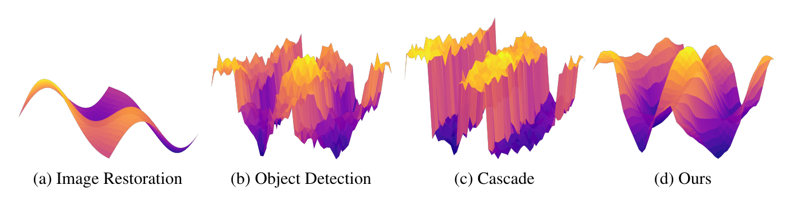
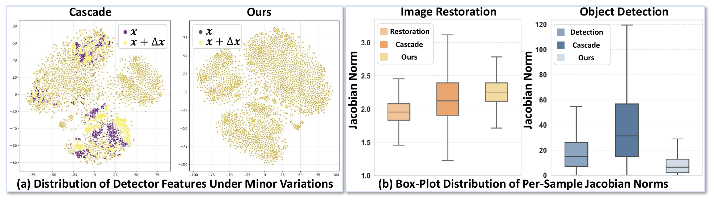
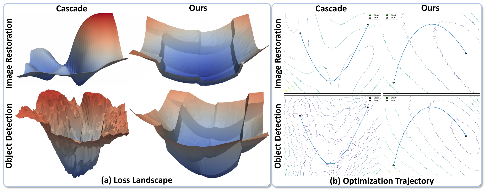

# [NeurIPS 2025] Delving into Cascaded Instability: A Lipschitz Continuity View on Image Restoration and Object Detection Synergy

[](https://proceedings.neurips.cc/paper_files/paper/2025/hash/f115f619b62833aadc5acb058975b0e6-Abstract-Conference.html)
[](https://arxiv.org/abs/2510.24232)
[](#citations)
[](LICENSE)

<a id="abstract"></a>

## 📝 Abstract

To improve detection robustness in adverse conditions (e.g., haze and low light), image restoration is commonly applied as a pre-processing step to enhance image quality for the detector. However, the functional mismatch between restoration and detection networks can introduce instability and hinder effective integration---an issue that remains underexplored. We revisit this limitation through the lens of Lipschitz continuity, analyzing the functional differences between restoration and detection networks in both the input space and the parameter space. Our analysis shows that restoration networks perform smooth, continuous transformations, while object detectors operate with discontinuous decision boundaries, making them highly sensitive to minor perturbations. This mismatch introduces instability in traditional cascade frameworks, where even imperceptible noise from restoration is amplified during detection, disrupting gradient flow and hindering optimization. To address this, we propose Lipschitz-regularized object detection (LROD), a simple yet effective framework that integrates image restoration directly into the detector’s feature learning, harmonizing the Lipschitz continuity of both tasks during training. We implement this framework as Lipschitz-regularized YOLO (LR-YOLO), extending seamlessly to existing YOLO detectors. Extensive experiments on haze and low-light benchmarks demonstrate that LR-YOLO consistently improves detection stability, optimization smoothness, and overall accuracy.

<a id="motivation"></a>

## 💡 Motivation



**Figure 1. Visualization of network functional behaviors under input perturbations.** (a) Image Restoration networks exhibit smooth, continuous mappings, where input changes lead to gradual adjustments. (b) Object Detection networks display sharp discontinuities due to abrupt decision boundaries in classification and bounding box regression. (c) Cascade frameworks (Image Restoration $\rightarrow$ Object Detection) magnify instability, resulting in fragmented and non-smooth behavior. (d) Our method integrates low-Lipschitz image restoration into the feature learning of high-Lipschitz object detection, promoting smoother transitions and enhanced stability.

<a id="dependencies-and-installation"></a>

## ⚙️ Dependencies and Installation

1. Install Pytorch and mmcv:

```bash
conda create -n LRYOLO python=3.10 -y
conda activate LRYOLO
conda install pytorch==2.5.1 torchvision==0.20.1 torchaudio==2.5.1 pytorch-cuda=12.1 -c pytorch -c nvidia
pip install -U openmim

# mim install mmcv==2.0.1
git clone https://github.com/open-mmlab/mmcv.git
git checkout v2.0.1
mim install -e .
```

2. Install mmdetection:

```bash
git clone https://github.com/diasuki/mmdetection.git
cd mmdetection
mim install -e .
```

3. Install mmyolo:

```bash
git clone https://github.com/diasuki/LR-YOLO.git
cd LR-YOLO
mim install -e .
```

<a id="datasets"></a>

## 🗂️ Datasets

1. Training Datasets:

| Dataset  | Link |
|----------|------|
| VOC_Haze |[GoolgeDrive](https://drive.google.com/file/d/1c8DCfQKRXDcoRTwWti_seOAtHI84Q_nz/view?usp=sharing)|
| VOC_Dark |[GoolgeDrive](https://drive.google.com/file/d/1NEQTtCUNK5QlA1_Fh1s7U6h_CfcCP-gO/view?usp=sharing)|

2. Testing Datasets:

|    Dataset   | Link |
|--------------|------|
| VOC_Haze_Val |[GoolgeDrive](https://drive.google.com/file/d/1mokbu4VuA_weakoOeMxOBd4SYsBtoaYz/view?usp=sharing)|
| VOC_Dark_Val |[GoolgeDrive](https://drive.google.com/file/d/1jBSPYTNiP5-5fUtVjdkP4KZ2i6ZQpnbj/view?usp=sharing)|
|     RTTS     |[GoolgeDrive](https://drive.google.com/file/d/1cSHq3axgTdViZZ8hAwAQEqD5Jd-cMmJC/view?usp=sharing)|
|    ExDark    |[GoolgeDrive](https://drive.google.com/file/d/1MmgT0-mc_Q_mhnqBF5fpC3QaNntvgL69/view?usp=sharing)|

<a id="pretrained-models"></a>

## 📦 Pretrained Models

| Dataset  | Detector | Link |
|----------|----------|------|
| VOC_Haze |  YOLOv8  |[GoolgeDrive](https://drive.google.com/file/d/1PLWj2-h3AzM8WnJ1Vn6CeDBCoDTFaNCb/view?usp=sharing)|
| VOC_Dark |  YOLOv8  |[GoolgeDrive](https://drive.google.com/file/d/1fbliGLevVcPiv7ZY0XcWOqApavvauTRB/view?usp=sharing)|
| VOC_Haze |  YOLOv10 |[GoolgeDrive](https://drive.google.com/file/d/1fvkrAMd3bcuvhbdB9HL_6NIVawtEd8cX/view?usp=sharing)|
| VOC_Dark |  YOLOv10 |[GoolgeDrive](https://drive.google.com/file/d/1eIwemKii0QJmSaBByYKZINmmVX69Xtcs/view?usp=sharing)|

<a id="testing"></a>

## 🧪 Testing

```bash
# python tools/test.py [config_path] [model_path] --show-dir show_results

python tools/test.py \
    configs/yolov8_voc_dark/3_finetune_yolov8_s_reconstruct_voc_dark_ep100_dark_train_no_aug_dark_test.py \
    work_dirs/3_finetune_yolov8_s_reconstruct_voc_dark_ep100_dark_train_no_aug/epoch_100.pth \
    --show-dir show_results
```

<a id="training"></a>

## 🚀 Training

1. single gpu:

```bash
# python tools/train.py [config_path]

python tools/train.py configs/yolov8_voc_dark/2_yolov8_s_reconstruct_voc_dark_100e_no_aug.py

python tools/train.py configs/yolov8_voc_dark/3_finetune_yolov8_s_reconstruct_voc_dark_ep100_dark_train_no_aug.py
```

2. multiple gpu:

```bash
# bash ./tools/dist_train.sh [config_path] [GPU_NUM]

bash ./tools/dist_train.sh configs/yolov8_voc_dark/2_yolov8_s_reconstruct_voc_dark_100e_no_aug.py 4

bash ./tools/dist_train.sh configs/yolov8_voc_dark/3_finetune_yolov8_s_reconstruct_voc_dark_ep100_dark_train_no_aug.py 4
```

<a id="analysis"></a>

## 🔍 Analysis

### 1. Input Space Analysis: Model Stability in Adverse Conditions



**Figure 2. Impact of haze density variations on feature stability and Lipschitz continuity.** (a) Distribution of the detector backbone's features between two haze inputs $\boldsymbol{x}$ and $\boldsymbol{x}+\Delta\boldsymbol{x}$ under minor haze density variations $\Delta\boldsymbol{x}$ on Pascal VOC [26] with synthetic haze. In the cascade framework, nearly half of the features shift under slight haze density variations, while our Lipschitz-regularized object detection remains stable. (b) Box-plot distribution of Jacobian norms $\|\nabla_{\boldsymbol{x}} f_{\boldsymbol{\theta}}(\boldsymbol{x})\|$ at each sample $\boldsymbol{x}$ between image restoration and object detection task on Pascal VOC [26] with synthetic haze. The Lipschitz constant of the object detection network is nearly an order of magnitude larger than that of the restoration network. This large disparity in Lipschitz continuity between the two tasks exacerbates the non-smoothness in the cascade framework. Our method constrains the Lipschitz constant of object detection to harmonize these two tasks better. ConvIR [11] and YOLOv8 [9] are taken as restoration and detection methods, respectively.

### 2. Parameter Space Analysis: Training Stability



**Figure 3. Parameter-space smoothness and optimization stability comparison between the cascade framework and our Lipschitz-regularized object detection.** (a) Loss landscapes of restoration and detection tasks: restoration networks demonstrate smooth trajectories, while detection networks encounter sharp gradient transitions, indicating instability. (b) The cascade framework amplifies this imbalance, leading to inefficient convergence and oscillatory optimization paths. (c) Our method introduces Lipschitz regularization to smooth the parameter space of object detection, enhancing stability and harmonizing it with restoration. ConvIR [11] and YOLOv8 [9] are used as representative restoration and detection methods, respectively.

<a id="citations"></a>

## 📚 Citations
If our work helps your research, please consider citing our paper, thanks.
The following are BibTeX references:

```
@article{zhao2025delving,
  title={Delving into cascaded instability: a Lipschitz continuity view on image restoration and object detection synergy},
  author={Zhao, Qing and Deng, Weijian and Wei, Pengxu and Dong, ZiYi and Lu, Hannan and Ji, Xiangyang and Lin, Liang},
  journal={Advances in Neural Information Processing Systems},
  year={2025}
}
```

<a id="acknowledgments"></a>

## 🙏 Acknowledgments

This project utilizes code from the following open-source implementations:

* MMYOLO: [mmyolo](https://github.com/open-mmlab/mmyolo)

* MMDetection: [mmdetection](https://github.com/open-mmlab/mmdetection)

* YOLOv10 (mmyolo implementation): [yolov10_mmyolo](https://github.com/Trami1995/YOLOv10)

* YOLOv10: [yolov10](https://github.com/THU-MIG/yolov10)

We are grateful to the authors of these repositories for making their work publicly available.
